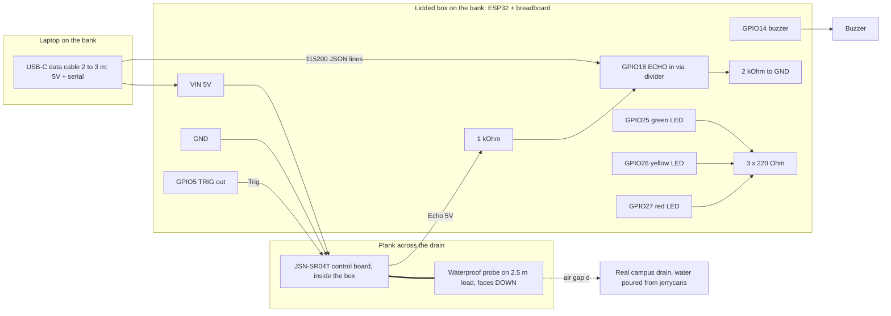

# TabaPort prototype by 7 October

## Is it possible?

Yes, if we build exactly what the four research documents already agree on and nothing more. Today is Sunday 4 October. The video is due 7 October (Phase 3 closes 9 October). That is three build days plus one buffer day.

What the research converged on (no new decisions needed):

- **Sensor (Eric + Trevor's alignment register):** 80 GHz radar is the field answer, but it is not a 3-day purchase. Generation 1 = **ESP32 + JSN-SR04T waterproof ultrasonic looking down at a real small drain**, mounted above the dead band.
- **Scene:** a real drain or culvert on campus or a private compound that you have **permission** to use. Not a KCCA public drain (that needs written KCCA permission). Water is poured in from jerrycans; real rain is a bonus, not the plan. A tank is the **rain-day fallback only**.
- **Stack (Sharif):** ESP32 firmware sending JSON lines over **USB serial** → **Flask + PySerial + SQLite** on the laptop → **Leaflet + GeoJSON** map. Three screens only: map, job list, live tank view.
- **Places (Trevor):** 17-point register, shortlist TP-04 Mulago, TP-03 Kalerwe, TP-01 Clock Tower, TP-11 Nalukolongo, TP-02 Bwaise. GeoJSON segments with `segment_id` (`clock_tower_01` pattern). Gazetteer and A\* router already written in his Appendix B.
- **Thresholds (Joel's lane):** yellow/red in cm, stored as config so field numbers replace tank numbers later. Silent node = `unknown`, never green.
- **Dispatch loop (Sharif §5):** alert → job → Assign → Ack → Close → False Alarm. Without this it is a graph, not a dispatch tool.

## Cut list (do not build before 9 October)

Radar sensor, LoRa, GSM/SIM800L, SMS/USSD gateway, cell broadcast, PWA, SpatiaLite, MQTT, locally rendered tile set (fallback below), AHP weighting UI, user accounts. Routing is a **stretch** only because Trevor's `safe_route()` already exists.

## Hardware: reuse the Arduino kit, buy only what is missing

The Arduino Uno board itself goes back in the box. The ESP32 replaces it. Everything else in the kit is useful.

**From your Arduino kit (UGX 0):**

- Breadboard
- Jumper wires (male-male and male-female)
- Resistor pack → echo divider: `1 kΩ` + `2 kΩ` (or two `1 kΩ` in series if there is no 2 kΩ; or `10 kΩ` + `20 kΩ`)
- LEDs (green, yellow, red) + 3 × `220 Ω` → **status lights on the node** so the camera sees the state change without looking at the laptop
- Buzzer → short beep on red
- HC-SR04 if it is in the kit → **backup sensor only** (not weatherproof; use it under a cut plastic bottle hood if the JSN-SR04T cannot be found)
- Uno USB cable is Type-B: **does not fit the ESP32**

**Buy (Neriko Electronics, Wandegeya; call +256 779 319 949 first, several items show out of stock online):**

- **ESP32 DevKit, ESP32-WROOM-32, 38-pin, CP2102, USB-C** — UGX 60,000. This is the recommended board: standard pinout, every Wokwi and tutorial example matches it, serial chip works on Linux/Windows without extra drivers. Avoid ESP32-S3 or ESP32-C3 for this build (different pins, more driver surprises).
- **Second ESP32 (strongly advised)** — UGX 60,000. One spare = insurance against a dead board on Tuesday night, and later Eric's upstream/downstream pair.
- **JSN-SR04T-3.0 waterproof ultrasonic** — UGX 25,000. Required for a real drain: the probe has a ~2.5 m cable, so the probe hangs over the water and the PCB stays dry in the box on the bank. Alternative if unavailable: A02YYUW waterproof ultrasonic (UART output, also fine).
- **USB-C data cable, 2–3 m** — UGX 15,000 to 20,000. The laptop sits dry on the bank; USB serial is reliable to about 3 m. Confirm it carries data, not charge-only.
- **Tape measure (3–5 m)** — UGX 5,000 to 8,000, for `H_sensor` and drain depth.

**Buy or borrow (hardware shop / home):**

- Lidded food container or small plastic box for the ESP32 + breadboard — UGX 5,000 to 10,000
- Wooden plank or metal bar to span the drain + cable ties + duct tape — UGX 10,000 to 15,000
- 2–3 jerrycans (20 L) of water to pour — borrow
- A sandbag, brick, or board to **temporarily** restrict flow downstream so the level rises while pouring, then remove it to show the drop (the "blocked culvert, then cleared" story). Use only on the private drain, and remove it after filming.
- Umbrella or shade for the laptop; a stool

**Totals**

- Minimum (one ESP32): ~UGX 120,000 to 140,000 (about US$33 to 38)
- Recommended (two ESP32s): ~UGX 180,000 to 200,000 (about US$50 to 55)

Boda delivery within Kampala is available from Neriko. Buy **Monday morning** or the schedule slips.

## Site (Eric + Trevor, Monday)

1. Pick a drain or culvert on campus or a private compound. Get **verbal and written permission** (a WhatsApp message from the owner or estates office is enough for this video).
2. Prefer a section where water already pools or a culvert inlet exists; a flat open gutter will not rise much when you pour.
3. Measure with the tape: drain depth to invert, width, and height of the road/path edge above the invert. Trevor records these; they become the real thresholds.
4. Mount the probe on the plank spanning the drain, centred, pointing straight down, **≥ 30 cm above the highest water you expect** (JSN-SR04T blind zone is 25 cm). Keep the probe at least 30 cm from a rough wall (Eric's note).
5. Electronics box on the bank, above any splash, cable with a drip loop before it enters the box.
6. Safety: nobody stands in the drain while filming; cables away from flowing water; laptop under shade.

## Final wiring schematic (for the video)

Power comes from the laptop USB-C cable. Nothing else powers the node. The JSN-SR04T runs on 5 V and returns a 5 V echo; ESP32 GPIO is 3.3 V, so the echo line needs the resistor divider from the kit. The three LEDs and the buzzer are from the kit and are driven straight from ESP32 pins through 220 Ω.



Pin table (write this on the one-pager Eric prints):

- ESP32 `VIN` (5 V from USB) → JSN-SR04T `+5V`
- ESP32 `GND` → JSN-SR04T `GND`, divider `R2` bottom, LED cathodes, buzzer `−`
- ESP32 `GPIO5` → JSN-SR04T `Trig`
- JSN-SR04T `Echo` → `R1 (1 kΩ)` → ESP32 `GPIO18`; `GPIO18` → `R2 (2 kΩ)` → `GND`. Result ≈ 3.3 V at GPIO18.
- ESP32 `GPIO25` → `220 Ω` → green LED; `GPIO26` → `220 Ω` → yellow LED; `GPIO27` → `220 Ω` → red LED
- ESP32 `GPIO14` → buzzer `+` (short beep on red; silent otherwise)
- JSN-SR04T control board stays **inside the box**; only the round probe goes out on its lead to the plank.
- Probe: perpendicular to water, centred over the channel, **≥ 30 cm above the highest water you expect**, ≥ 30 cm from a rough wall.

If the HC-SR04 from the kit is used as backup, the wiring is identical (`VCC, Trig, Echo, GND`). Keep it dry under a cut plastic bottle hood and keep the demo short.

Calibration (from `CalculationTabaPort.docx`): measure `H_sensor` = distance from probe face to the drain invert with the tape, dry. Then `H_water = H_sensor − d_measured`. Put `H_sensor` in the config table, not in code. Also record `H_road` = height of the path/road edge above the invert.

Thresholds for the video (Joel decides, Eric and Trevor confirm from the tape): a sensible default is **yellow when the water reaches 50 % of drain depth, red at 80 %** or when it is within 10 cm of the road edge. Write them as cm in config. If the drain is 60 cm deep: yellow ≥ 30 cm, red ≥ 48 cm. Rain-day tank fallback: yellow ≥ 8 cm, red ≥ 15 cm.

## Firmware (ESP32 only; no Arduino board) — what it must do

The ESP32 is the only microcontroller. "Arduino" below means the Arduino _framework/IDE_ used to program the ESP32, not a second board. MicroPython on the ESP32 is an acceptable alternative (`machine.time_pulse_us` replaces `pulseIn`); pick one on Sunday and do not switch.

**Wokwi (simulator): use it Sunday and Monday, never in the video.**

- Wokwi simulates an ESP32 with an HC-SR04 / JSN-SR04T model and a serial monitor, so the firmware can be written and the JSON output checked before any part is bought.
- Wokwi for VS Code can publish the simulated serial port over TCP (`[[net.forward]]` / `rfc2217ServerPort` in `wokwi.toml`), so Sharif's PySerial reader can be tested against the simulator over `rfc2217://localhost:4000` before the real board exists. This replaces the earlier "fake serial with random numbers" idea.
- Keep `diagram.json` and `wokwi.toml` in `firmware/tank_node/` so anyone can re-run it.
- IEEE's Phase 3 email forbids "simulated interaction." A Wokwi slider is simulated interaction. On 7 October the camera must show a real probe over a real tank with water poured by hand. Wokwi footage may not appear in the video.

- Trigger every **500 ms** (2 Hz; faster than Sharif's 0.5 Hz so the screen moves visibly on camera).
- Read echo with `pulseIn`, convert to cm (`d = t × 0.0343 / 2`).
- **Moving median of 5** raw readings (the floating-plastic filter from Phase 2). Flag a reading `filtered: true` if it deviates > 10 cm from the median.
- Print one JSON line: `{"node_id":"drain_01","raw_cm":41.2,"level_cm":8.8,"filtered":false}`.
- Drive the kit LEDs from the same thresholds the laptop uses (send thresholds down once over serial at startup, or hard-code the same numbers for the video): green / yellow / red, buzzer one short beep when red starts. If no echo for 5 readings, blink all three LEDs = sensor fault.
- No Wi-Fi, no sleep, no LoRa.

## Laptop app (Flask + SQLite + Leaflet) — what it must do

Follow Sharif's four tables exactly (`node_reading`, `road_segment_state`, `job`, `human_report`) so his document and the code match.

1. **Serial reader thread** (PySerial): parse JSON lines, insert `node_reading`, compute `rise_rate_cm_per_min` over a 60 s window.
2. **State engine:** map `drain_01` → one `segment_id` (e.g. `clock_tower_01`, or a new `campus_drain_01` that Trevor adds to the GeoJSON at the real site coordinates). Apply thresholds from a config table → `green/yellow/red`. If no reading for **10 s** → `unknown`. On transition to yellow/red, create an alert and an open `job`.
3. **Map screen:** Leaflet, Trevor's `blackspots.geojson` (TP-01..17) and 5 shortlist `road_segments.geojson`, coloured by state. **Basemap fallback:** if Trevor's locally rendered tiles are not ready by Tuesday evening, use a plain dark background with the GeoJSON only. Do not use the public OSM tile server (policy forbids offline use and the laptop will be offline anyway).
4. **Job list screen:** Sharif §5.8 columns, one-click **Assign / Ack / Close / False Alarm**, unacked jobs on top, 3-minute escalation flash.
5. **Live node screen:** raw vs filtered line over last 5 minutes, water depth and "cm below road edge", current state badge, "unknown" when USB is pulled.
6. Everything served at `http://localhost:5000`. Turn Wi-Fi off during filming to prove offline.

Stretch (Wednesday only if screens 1–5 work): hook Trevor's `safe_route()` to a "Route crew" button that excludes red segments.

## Repository layout to create (you write the code)

```
firmware/tank_node/tank_node.ino   (or main.py if MicroPython)
firmware/tank_node/diagram.json    Wokwi circuit (ESP32 + ultrasonic + divider)
firmware/tank_node/wokwi.toml      Wokwi config incl. serial-over-TCP for PySerial tests
hub/app.py            Flask + PySerial thread + SQLite (serial URL configurable: COM/ttyUSB or rfc2217://localhost:4000)
hub/schema.sql        Sharif's 4 tables + config table
hub/static/           leaflet.js, leaflet.css, app.js
hub/templates/        map.html, jobs.html, tank.html
hub/data/blackspots.geojson, road_segments.geojson, gazetteer.json
hub/gis/router.py     Trevor's Appendix B functions
docs/phase3/wiring.md  the schematic above + photos
docs/phase3/bom.md     the budget above with receipts
```

## Day-by-day

**Sun 4 Oct (today, evening):** Lock this plan with the team. Sharif creates the repo skeleton and `schema.sql`. Trevor exports `blackspots.geojson` + 5 segments. Shakiran writes the firmware in Wokwi (ESP32 + ultrasonic model) and exposes its serial over TCP so Sharif's PySerial reader works before parts arrive. Eric drafts the one-page wiring + calibration sheet. Joel writes the job wording (`Send drainage crew`, `Ask traffic police to close lane`, `Desilt inlet`).

**Mon 5 Oct:** Eric buys parts in Wandegeya (morning); Eric + Trevor pick the drain, get permission, measure depth / width / road edge, photograph it. Shakiran: wire on the kit breadboard, flash the real ESP32, see JSON and LEDs change by waving a hand under the probe. Sharif: serial thread + state engine + live node screen. Trevor: `campus_drain_01` segment and site point added to GeoJSON; map loads offline.

**Tue 6 Oct:** Job list screen with the four buttons. Go to the drain: mount plank + probe, box on the bank, measure `H_sensor`, put thresholds in config. End-to-end on site: pour → yellow → red → job → Assign → Ack → remove the block → level drops → Close. Pull USB → unknown. Dress rehearsal with the camera position fixed. Trevor: tiles in only if finished; otherwise fallback.

**Wed 7 Oct:** Film at the drain, morning light (two takes). If it rains hard, film the tank fallback indoors. Edit to 2–5 min. Upload to IEEE portal. Buffer Thu 8 Oct for re-shoot; portal closes 9 Oct.

## Video shot list (meets IEEE: real person, real interface, real-time, Kampala scenario)

1. 15 s: Shakiran at the drain, problem statement, points at the probe on the plank and the box on the bank.
2. 30 s: Eric restricts flow downstream and pours from the jerrycan; the node's LED goes green → yellow → red, buzzer beeps; live node screen climbs in step.
3. 45 s: Joel as dispatcher at the laptop: map shows the drain segment red; job appears; taps Assign → Team A, Ack.
4. 30 s: Eric floats a plastic bottle under the probe; raw spikes, filtered holds (the Phase 2 filter, live, in a real drain).
5. 20 s: Shakiran pulls the USB; segment goes `unknown` (not green); LEDs show fault. Plug back.
6. 30 s: Eric removes the block ("crew cleared the culvert"); level drops on screen; Joel taps Close; segment green. Optional False Alarm demo.
7. 20 s: Trevor zooms the map out to the 17-point Kampala register and the 5 shortlist sites; one line on the KCCA pilot ask.
8. 10 s: Close: Wi-Fi off icon shown on the laptop; "runs offline on the bank".

## Who does what

- **Shakiran:** firmware, serial integration, filming, upload, keep scope.
- **Sharif:** Flask app, SQLite, state engine, job list, live chart.
- **Trevor:** GeoJSON files, gazetteer, map screen, (tiles if time), router stretch.
- **Eric:** parts purchase run, drain selection and permission (with Trevor), plank + probe mount, box on the bank, `H_sensor` calibration, wiring one-pager, pours water and clears the block on camera.
- **Joel:** yellow/red cm from the measured drain depth and road edge, job action wording, plays dispatcher on camera, writes the 3-line "after the alert" caption.

## Risks and the fallback for each

- JSN-SR04T out of stock → A02YYUW waterproof if Neriko has it; else kit HC-SR04 under a plastic hood for a short dry-weather take (same wiring, same code).
- Heavy rain on Wednesday → film the tank fallback indoors; keep the drain photos from Tuesday in the video for context.
- Drain does not rise when pouring → restrict flow downstream with a board/sandbag before pouring; remove it after.
- No permission by Monday evening → use the tank at home; do not film on a public drain.
- Local tiles not rendered → GeoJSON on plain background; still offline and honest.
- Serial noise → median of 5 already in firmware; raise to 7 if needed.
- Charge-only USB cable → buy a known data cable; test with the serial monitor in the shop if possible.
- Running late Wednesday → film screens 1–5 only; skip routing and False Alarm; the dispatch loop is the product.
