# TabaPort progress report after IEEE Phase 2

**IEEE Response Quest Challenge. Concept 5267.**  
Flood watch and crew dispatch for Kampala that still works with no internet.

| Field | Value |
| --- | --- |
| Document | Team research and first build progress report |
| Date | 9 October 2026 |
| Version | 3.0 |
| Phase 2 | Idea sent 24 May 2026. Moved to Phase 3. |
| Phase 3 | Video of a real person using a working product. Portal closes 9 October 2026. |
| SRS | First build, October 2026 (docs/SRS.md) |

This report puts the team research in one place. Water, drain, map, and software sit with what we then built. **Drawings and site photos come from Eric and the calculation file.** Screen shots come from the first laptop app. News and papers are cited. We do not pretend they are our lab results.


## The team

Phase 2 was filed as **one IEEE name** (Shakiran Nannyombi). That PDF did not list a team. After Phase 2, five people did the work. Put these names on the PDF cover, the video end card, and every file you send with the video.

| Name | Role | What they did |
| --- | --- | --- |
| **Shakiran Nannyombi** | Lead. IEEE member. Named on Phase 2 and Phase 3. | Idea, firmware, chair of research week, dispatcher on camera, join the parts. |
| **Joel** | Water, crew, words on the screen | When a road is unsafe. The 50 percent and 80 percent rule. Job words. Pour and timing on film day. |
| **Eric** | Drain, box, sensor place | What drain. How to mount. Trash versus water. Threats. Maths. Hardware. Crew on camera. |
| **Mugisha Trevour Jeanclaude** | Maps and land. Makerere Land Surveying. Finish due August 2027. | 17 flood places. Earth Engine score. Map files with no internet. Camera and site. |
| **Sharif** | Software | Map choice. Four tables in SQLite. USB link. Job flow. SRS. Flask hub. |

Working notes also say **Trevor** for Mugisha Trevour Jeanclaude. Add family names for Joel, Eric and Sharif on the printed cover if you have them.

**How we split the research** (do not do someone else lane):

* Joel: water and the crew. When is a road unsafe? After an alert, who acts?
* Eric: the drain and the box. Where can a sensor sit?
* Trevor: place and the map. Which sites are real? What map is good enough?
* Sharif: software. What can we code in time?
* Shakiran: chair. Write what the four decide. Do not bring a finished design.


## 1. What this report is for

IEEE Phase 3 needs a **video**. The video is not the research. This file is the research and the build, so a judge or a teacher can see:

1. what Phase 2 claimed
2. what each person found, with sources
3. what we locked as the first build
4. what the product does (with screen shots)
5. what we still do not claim

TabaPort in one sentence: a water sensor on a drain feeds a laptop with no internet. Roads show **green, yellow, red, or unknown**. A job opens so a dispatcher can send a crew **before** the road floods.

It does not stop flooding. KCCA channels move water. TabaPort tells crews **where the water is**.


## 2. The problem, and the posts we used

When heavy rain hits Kampala, drains at Clock Tower, Bwaise, Kalerwe and other flood spots can close in **minutes**. Plastic and silt block channels. Phone networks jam or drop. Crews, traffic police, boda riders and commuters then cannot see which drain is rising, which road is open, or where to send the next truck. Today that is radio, WhatsApp, and people standing in water.

KCCA is building channels. That does not remove the need for a live water level. Building moves water. TabaPort sits **on top** of that work, also while channels are still being built, and after waste and silt block the new ones.

### 2.1 Numbers we reuse (as written by others)

| Number | What it is | Where we took it |
| --- | --- | --- |
| About 362 km of drains | Eight catchments: Nakivubo, Lubigi, Walufumbe, Nalukolongo, Kansanga, Kinawataka, Nakamiro, Mayanja | KCCA briefs. Phase 2. Concept note. |
| 69 flood spots | Sites that still need watch | KCCA. Concept note. |
| UGX 768 billion | Drain works ask, 2026/27 to 2030/31 | KCCA and Parliament briefs |
| About US$50 million a year | Flood damage (UNDP figure in the inquiry) | Monitor and Parliament story |
| 980 m of Lubigi not finished. Nsoba and Kiwunya just started. Jugula more than 90 percent taken by buildings. | Works are a five year plan, not a finished city | KCCA and UBC updates |

KCCA Deputy ED Benon Kigenyi: *"We cannot stop the rain, but we can prepare Kampala to manage it better."* He also said new drains fail if waste and silt keep blocking them ([KCCA news 1154](https://www.kcca.go.ug/news/1154/). [UBC, 12 August 2026](https://ubc.go.ug/2026/08/12/kcca-steps-up-drainage-works-to-tackle-flooding-in-kampala/)).

Parliament asked KCCA for a [7 day report](https://www.monitor.co.ug/uganda/news/national/parliament-gives-kcca-7-days-to-explain-kampala-flooding-5543126) after visits at Nalukolongo Najjanankumbi, Lugogo and Kyambogo.

[NTV](https://ntv.co.ug/news/kcca-urges-land-donation-to-solve-kampala-flooding) said KCCA asked for land so channels can grow. Those roads stay small for years. Those are the sites that need a sensor and a detour. Do not say the civil works already solved them.

| KCCA is building | TabaPort adds |
| --- | --- |
| Bigger channels and culverts | Live water level at those same places |
| 69 flood spots watched by patrol | A ranked job list so the first truck goes to the worst site |
| Trucks ready when rain starts | A map with no internet: red, yellow, green |
| Waste and silt as the leftover failure | A median filter for floating plastic, plus a report from a rider who saw the block |
| A five year master plan | Eyes during the years of building |


## 3. What Phase 2 claimed, and what we cut

**Phase 2 file:** docs/phase2/QM_Idea_5267_08_23_2026.pdf  
**Title:** Tabaport: On Site Edge Intelligence and Dispatch System for Urban Flash Floods (5267)  
**Author on the form:** Shakiran Nannyombi. Sent 24 May 2026. **Is this a team submission? No.**  
**Result:** moved to Phase 3.

### 3.1 The idea (seven pages)

1. **Nodes.** ESP32 plus a sealed ultrasonic in culverts. A moving median on the chip so floating plastic is not a flood. Sample every 30 seconds. Aim under US$55 per node.
2. **Hub.** Laptop or Raspberry Pi. SpatiaLite and OSM. No internet.
3. **AHP rank.** Rank sites by how fast water rises, hospitals and flyovers, and how many people live there.
4. **A star routes.** A red road gets a huge cost. Detour on high ground (for example the Northern Bypass).
5. **Human reports.** USSD or SMS from boda riders. Place name match. 100 m circle until a sensor or a crew confirms.
6. **Privacy.** Drop the phone number and IMSI at the door. MIT licence.
7. **Public loop.** Cell broadcast SMS in a 2 km ring and KCCA social posts when a node goes red.

Phase 2 sources named on the form: KCCA Drainage Master Plan. OpenStreetMap Uganda. UNMA. IEEE Systems Council notes.

IEEE review (IT, legal, finance names in the PDF) passed the **idea**. That is not a lab test of the hardware.

### 3.2 What the first build actually is

| Phase 2 line | First build (this report and the video) |
| --- | --- |
| Solar, LoRa, BLE, GSM fallback | USB serial, 115200, one cable |
| SpatiaLite | SQLite and GeoJSON. Map work done **before** the rain |
| Sample every 30 s | 2 Hz (500 ms) so the chart moves on camera. Field sample time is still an open power question |
| Cell broadcast 2 km | **Not ours.** UCC and the phone companies. A typed report on the hub instead |
| Raspberry Pi city hub | One laptop. WiFi **off** |
| US$55 production node | USB lab or campus node (about UGX 138000 to 198000 parts) |

Sharif last line, which the team locked: *if we cannot acknowledge, assign and close, we only have a graph, not a dispatch tool.*


## 4. One system, five owners

The four research files stay one product if they share names. Do not type the same place twice with two different numbers.

| ID | Meaning | Owner |
| --- | --- | --- |
| place_id TP 01 to TP 17 | Flood place list | Maps |
| segment_id for example clock_tower_01 | Coloured road stretch | Sharif and GeoJSON |
| node_id for example drain_01 | Physical sensor | Firmware and hub |

Eric owns the culvert and the node hardware. Sharif owns readings, segments and jobs. Joel and Shakiran own crew words and the IEEE cut. Trevor owns the place list and the map files.


## 5. Joel: water, bands, and what happens after the alert

**Source:** docs/phase3/thresholds-and-words.md and the research week brief.

Joel was asked not to wait to be told the centimetres. Books do not give one "unsafe for a boda" number for every Kampala drain. Depth is measured **at the site**.

### 5.1 Two tapes, then the bands

* **H_sensor:** probe face to drain floor (invert), dry.
* **H_road:** road or path edge to invert.

Water depth on the laptop is the same formula Eric drew (Figure E9): H_water = H_sensor minus d_measured.

| Band | Default rule | Tank fallback (drain under 40 cm) | Meaning for the road |
| --- | --- | --- | --- |
| **Green** | depth under 50 percent of H_road | under 8 cm | Drain is working. Nothing to do. |
| **Yellow** | depth at or above 50 percent of H_road | at or above 8 cm | Filling faster than it empties. Inlet is probably blocked. Send someone **now**. |
| **Red** | depth at or above 80 percent of H_road, **or** within 10 cm of the road edge | at or above 15 cm | Water on the road in minutes. Close the lane. Clear the inlet. |
| **Unknown** | no reading for 10 s | same | We do not know. **Never green.** Treat as yellow for routes. |

Example: 60 cm drain, probe 50 cm above the floor. Yellow at **30 cm**. Red at **48 cm** (also within 10 cm of the 50 cm edge). Settings works this out from H_road.

**Why 50 and 80.** KCCA drains have freeboard. Half full during rain is fine **only if the water is moving**. Half full and rising means the inlet or outlet is blocked. Eighty percent leaves about the time a city crew needs to reach a flood spot from the Clock Tower depot in traffic (about 10 to 15 minutes) before the path is wet.

Rise rate (cm per minute over the last 60 s) is **shown** in the first build. It does not change the band until we have real storm data. A rise above 5 cm per min in a storm is a later rule that the inlet is blocked, not just a full drain.

### 5.2 After the alert: who does what

If this flow is missing, Sharif said, we only have a graph.

| Trigger | Job words on the laptop |
| --- | --- |
| Yellow | **Send drainage crew to check inlet** |
| Red | **Ask traffic police to close lane. Send drainage crew to clear inlet** |
| Human report, no sensor | **Send drainage crew to check inlet** (segment yellow. Never red without a sensor or a crew on site) |
| Opened by hand | dispatcher types the action |

Statuses: open, then acked, then en route, then on site, then closed. Side exit at any step: false alarm with a reason.

Rules Joel wrote (and Shakiran says on camera):

1. Acknowledge within **3 minutes**. After that the row flashes.
2. Assign a crew before or at acknowledge.
3. **Closing a job does not paint the road green.** Only the sensor does. If the crew clears the inlet, the water drops and the sensor turns it green itself.
4. False alarm reasons we expect: debris under the probe, crew found the drain clear, test pour.

Demo crews: Team A Central. Team B Kawempe. Team C Rubaga. Traffic Police.

Spoken lines (video):

1. Yellow. *"Campus drain is at thirty centimetres and rising. That is yellow. I am sending Team A to check the inlet."*
2. Red. *"Forty eight. Red. Water is ten centimetres from the path. I am asking traffic to close the lane."*
3. Level falling. *"The sensor will turn it green on its own. I close the job when Team A reports clear."*
4. USB pull. *"I have lost the node. It goes grey, not green. I do not guess."*


## 6. Eric: the drain, the box, and the sensor

**Sources:** docs/Research/TabaPort_eric.docx (Drainage Sensor Placement for Urban Flood Monitoring). docs/Research/CalculationTabaPort.docx. docs/phase3/wiring.md. docs/phase3/bom.md.

### 6.1 What kind of drain, and where a sensor can sit

KCCA drains are main and second channels, community drains, road crossings and box culverts. Size at one site must come from drawings or a tape, not from "a standard Kampala drain." Eric note opens with the structures.

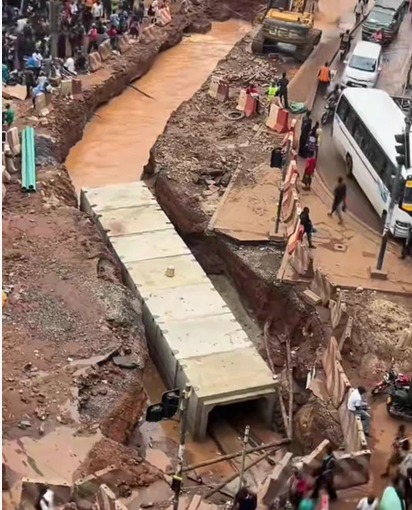

**Figure E1.** Box culvert (from Eric placement note). Sensor place: on the ceiling slab or headwall, **upstream** of the inlet splash, not in the silt on the floor.

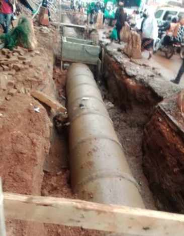

**Figure E2.** Pipe culvert. Uganda guide in the note: at least **600 mm** under a road. Sensor sees water at an open chamber upstream, not inside the pipe.

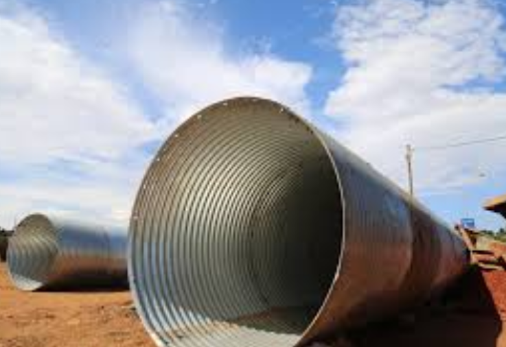

**Figure E3.** Corrugated metal pipe. Same job as a concrete pipe. Mount and blind zone rules do not change.

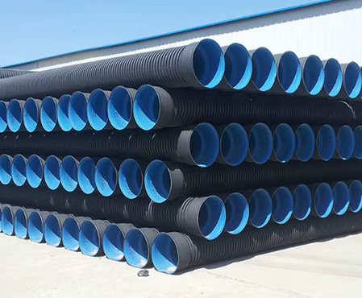

**Figure E4.** Plastic pipe. Community drains often use these. Still measure width, floor and trash before you pick a mount.

| Situation | Likely structure | Sensor sees water | Trash and silt |
| --- | --- | --- | --- |
| Roadside runoff | Open rectangle or trap channel | Stable section upstream | Litter at low points |
| Community drain | Small channel | Protected wall or overhead | Household waste, plants |
| Road crossing | **Box culvert** (Fig E1) | Upstream of the crossing, clear of splash | Debris at inlet, silt on floor |
| Smaller crossing | Pipe culvert (Figs E2 to E4) | Chamber upstream | Block at inlet |
| Main channel | Main or second channel | Stable section with a known height | Large debris, erosion |

Uganda road drain guide in Eric note: pipe culverts under roads at least **600 mm**. Precast box often **600 mm by 450 mm** (sometimes 450 mm by 400 mm if the flow scours itself). Kampala tables go larger (pipes 750 to 1200 mm. Boxes 1 to 6 m span). **Survey the site.**

**First build rule.** An old, stable box culvert or open channel at a **known** flood spot. Not a section about to be rebuilt (Trevor then ranked the rebuilt Nakivubo at St Balikuddembe **low** for a first sensor).

### 6.2 Three ways to sense (Eric comparison drawing)

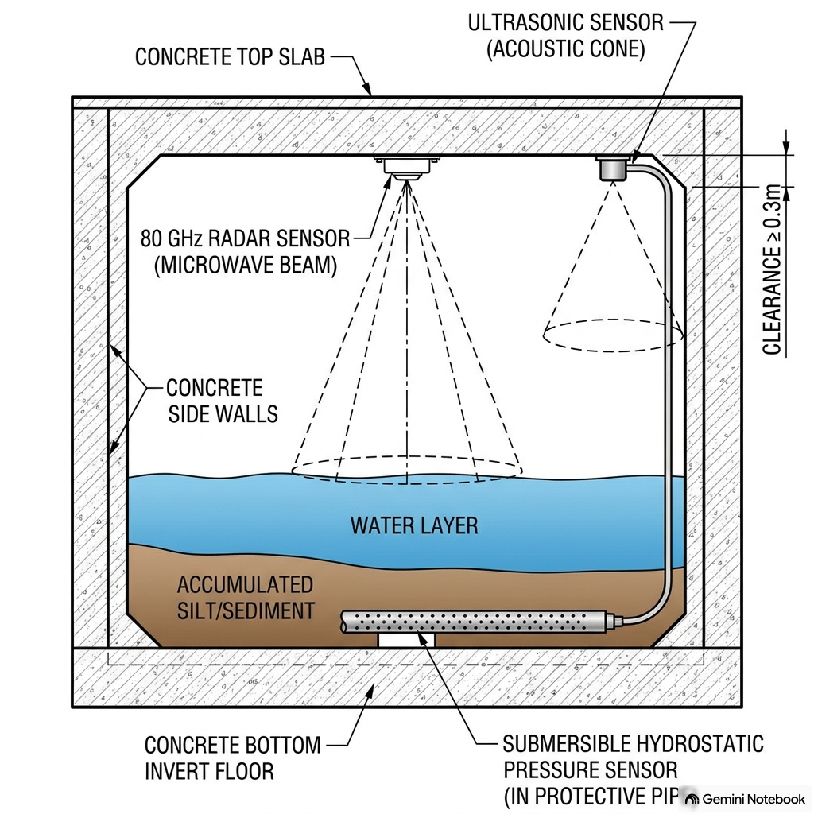

**Figure E5.** Eric comparison. Radar and ultrasonic look down at the water. Pressure sits in the silt. That is why the note rejects it for silt watch.

| Way | Strength | Weakness in a Kampala drain | First build |
| --- | --- | --- | --- |
| **80 GHz radar** | Foam, steam, splash. About 2 mm. Tracks silt when dry by a shorter air gap | Cost. Shop wait | **Later** (Eric field pick) |
| **Ultrasonic (JSN SR04T)** | Cheap. No contact. Same time of flight idea | Air heat. Foam. 25 cm blind zone. Wet face | **What we bought and filmed** |
| **Pressure** | Direct depth from the bed | Buries in silt. Face clogs | Not for silt watch |

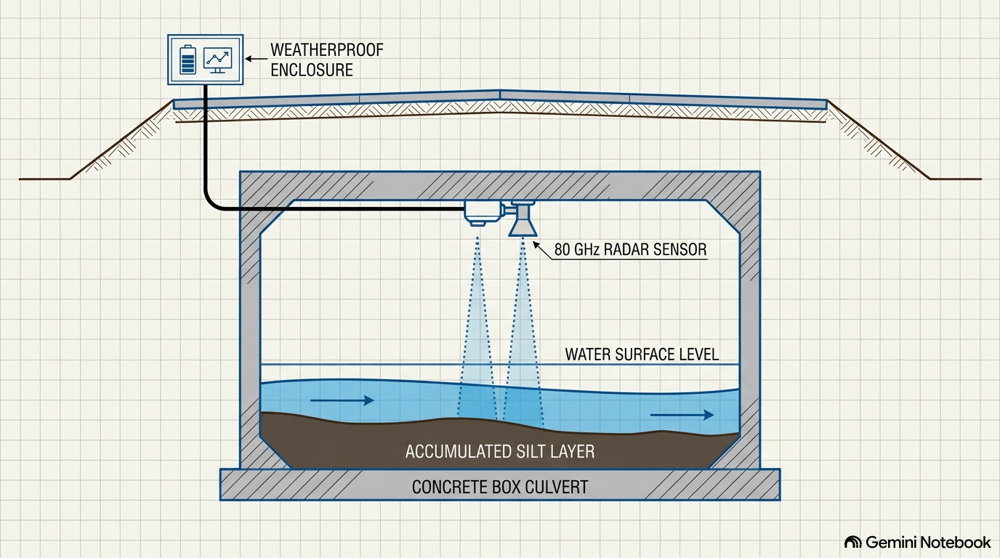

**Figure E6.** Radar only section from the placement note. This is the **field** pick, not what we filmed.

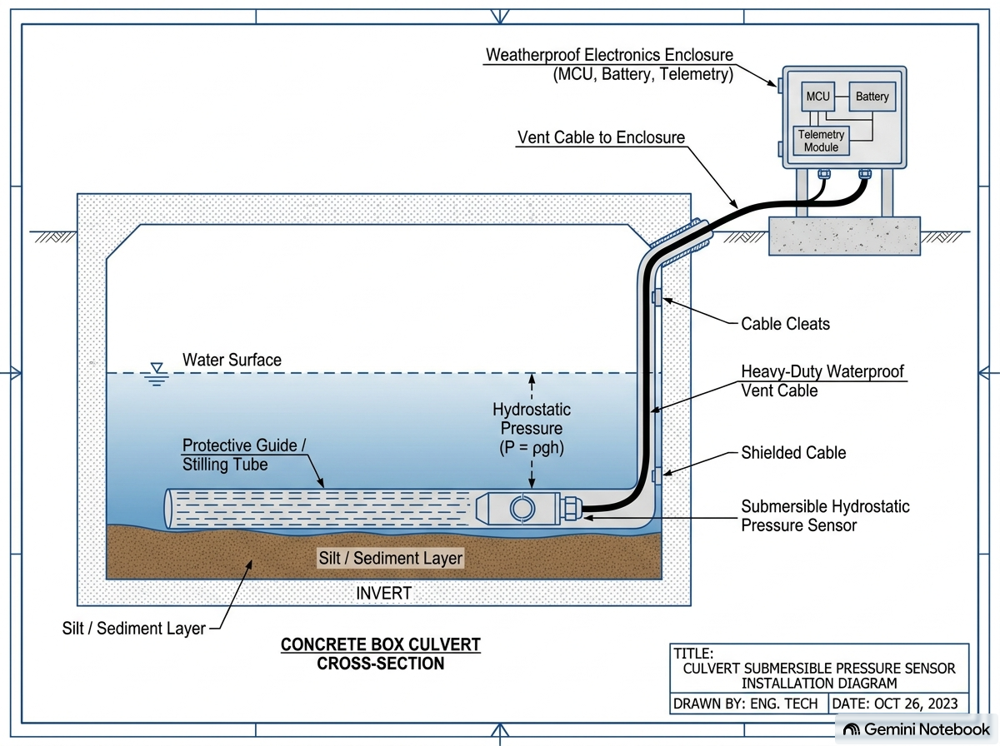

**Figure E7.** Pressure install. Eric: sand and mud bury the face. Drift and failure follow.

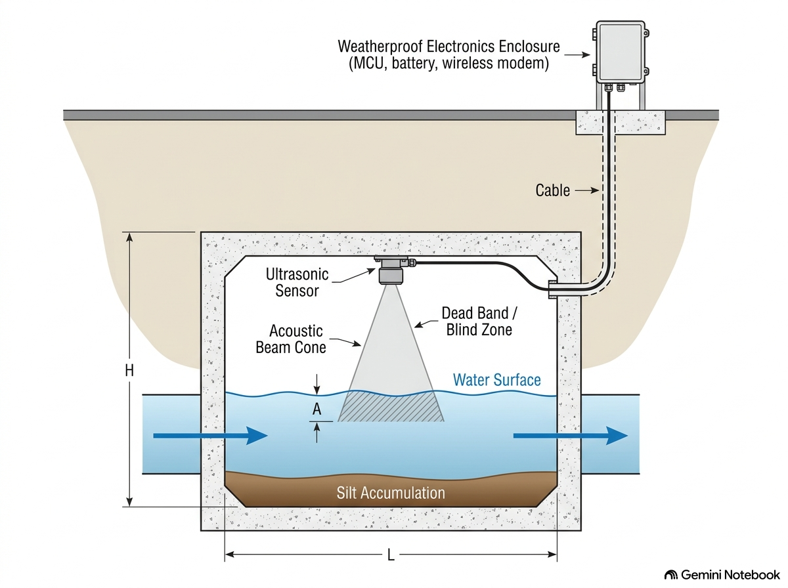

**Figure E8.** Ultrasonic (what the first build uses). Blind zone **A** must stay above max water. Height **H** and length **L** are taped on site.

Eric field pick is radar. The team still chose ultrasonic for Phase 3 because Neriko could sell a JSN SR04T the same morning (about UGX 25000) and the IEEE date would not wait on radar. If ultrasonic stays: stilling tube, 30 cm from a rough wall, 30 cm above max water, heat later.

**Where the sensor must not go**

* On the floor (silt). See Figure E7.
* In the inlet splash (branches, plastic).
* In the centre of the flow (desilt shovel).
* On a drain about to be dug up.
* In an obvious box that invites theft.

### 6.3 The maths from the calculation file

These drawings are from docs/Research/CalculationTabaPort.docx. They are the same formulae the hub and firmware use.

Distance with no contact (radar or ultrasonic):

d_measured = (v times t) / 2

Firmware (SRS): raw_cm = (echo microseconds times 0.0343) / 2. Speed of sound about 343 m/s.

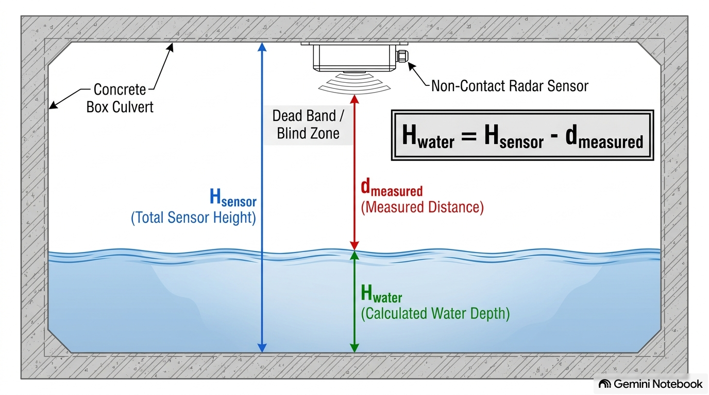

**Figure E9.** Calculation note. H_sensor is the dry tape from probe face to floor. d_measured is the live echo. The laptop and the node both work out H_water. The hub numbers are the source of truth.

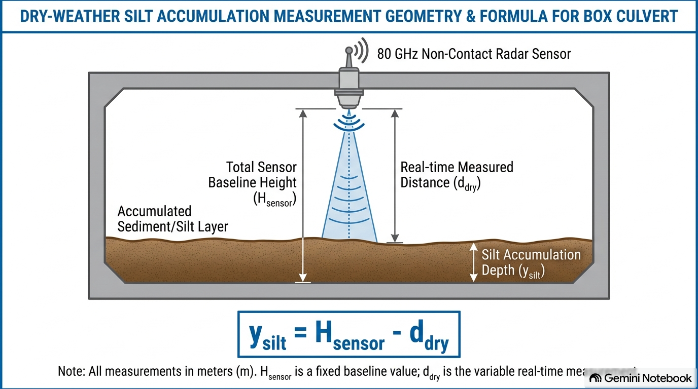

**Figure E10.** Same shape, dry channel. A lasting shorter air gap is silt on the bed, not a flood. Second build check. First build still needs a clean floor so H_sensor is true.

Blind zone: radar a few centimetres. Ultrasonic often **5 to 25 cm** (JSN SR04T about 25 cm). The probe must sit high enough that max flood never enters that zone.

Speed of sound shifts about **0.6 m/s per degree C** (about 1 cm error per 10 C at 50 cm). The field node design adds a heat sensor. The first USB node does not.

### 6.4 Two sensors for a block, and the field system Eric wants

Measure water where it has a clear meaning. Do **not** put the main sensor in the trash pile. Watch the **effect** of a block from upstream of the inlet.

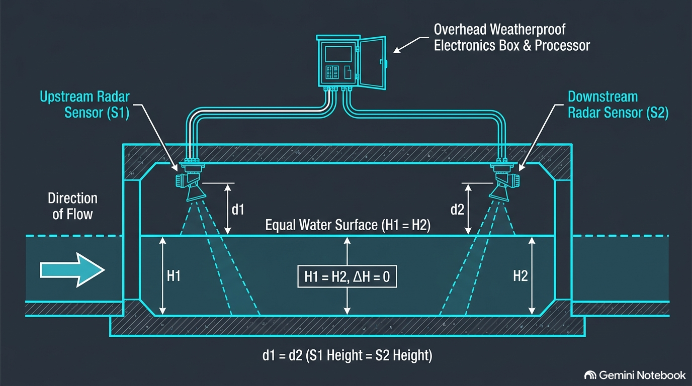

**Figure E11.** Block idea. Head gap (H upstream minus H downstream) rises when the crossing holds flow. Second build (two nodes). First build has one node.

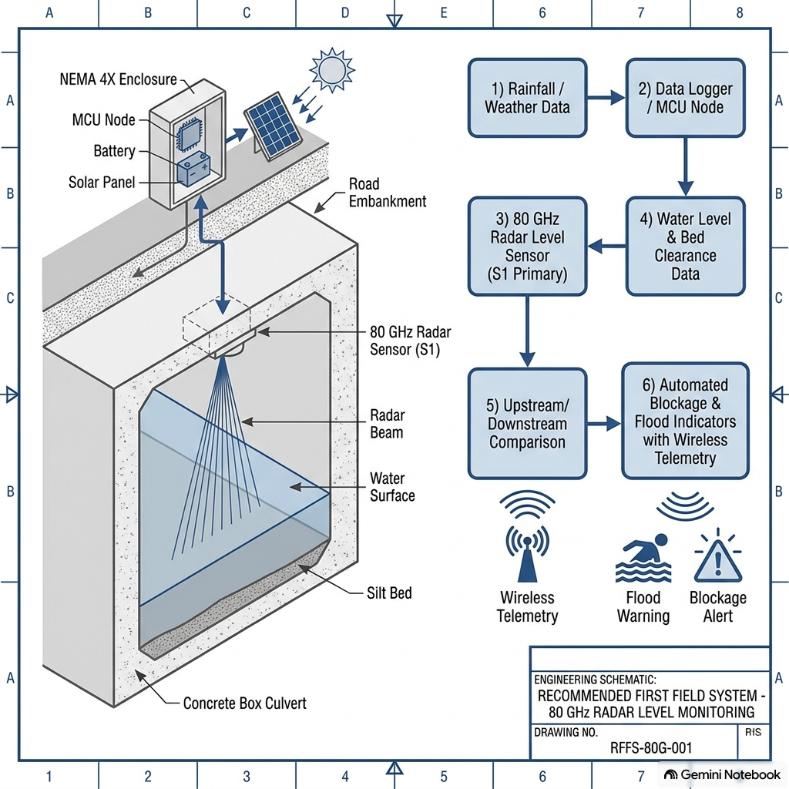

**Figure E12.** Field target after the IEEE video. Not what we filmed. First build is USB plus ultrasonic plus laptop.

### 6.5 How the sensor is fixed to the slab (calculation note)

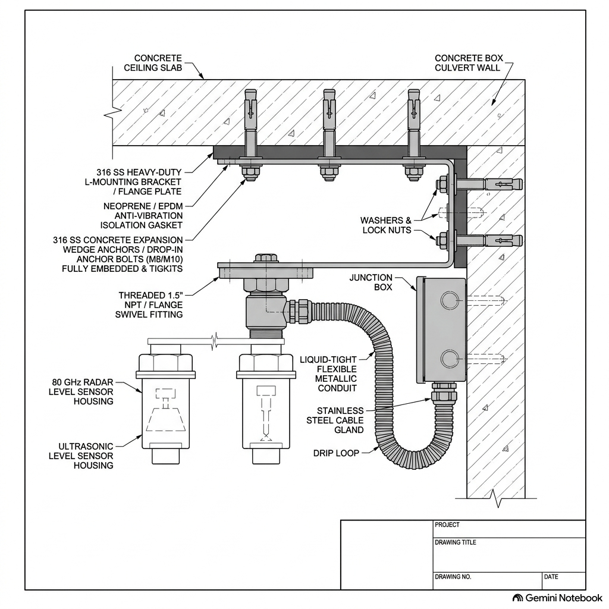

**Figure E13.** Calculation note. Suggested install. Probe straight at the water. At least 0.3 m from a rough wall. Downstream of the inlet splash. Blind zone clear of max flood. Cable in conduit with a drip loop **before** the box.

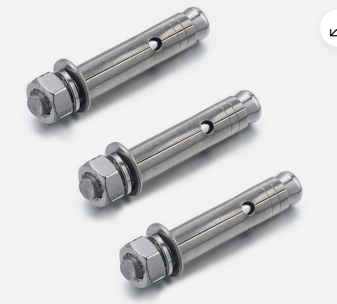

**Figure E14.** Wedge anchors from the calculation note (that file labels this "Figure 1: M8/M10 wedge expansion anchors"). First build used a plank and cable ties across a small campus drain. This drawing is the public culvert mount, after permission.

### 6.6 Threats and what we do

| Threat | What happens | What we did or plan |
| --- | --- | --- |
| Splash and waves | Unstable ultrasonic | Away from inlet. Plank mount. Stilling tube later |
| Trash | Spike or strike | Median of 5 plus 10 cm gate (Phase 2 filter, live) |
| Silt | Pressure sensor dies. Floor changes | Overhead only. Dry y_silt later |
| Sun and UV | Box dies | Lunch box for the video. Outdoor box later |
| Theft | Whole node gone | Bank box. Short film. No public install |
| Desilt | Crew hits the probe | Outside the shovel path. Talk to the crew |
| Building work | Shape changes | Eric and Trevor: skip rebuilt sections |

KCCA already clears silt by hand and machine and works with communities. The box has to survive **maintenance**, not only rain.

### 6.7 First build wiring (what Eric and Shakiran built)

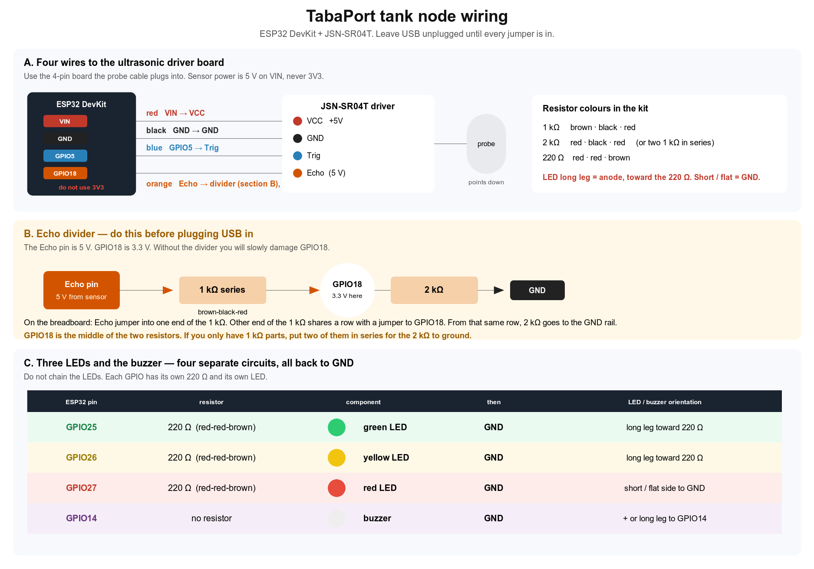

**Figure E15.** Printable wiring for the video node. VIN (5 V) to the JSN SR04T, **not** 3V3. Echo is 5 V. 1 k ohm and 2 k ohm divider into GPIO 18.

| Function | ESP32 pin |
| --- | --- |
| Sensor power | VIN (5 V from USB) |
| Trig | GPIO 5. 20 us every 500 ms |
| Echo | GPIO 18 via divider |
| Green, yellow, red LED | GPIO 25, 26, 27 plus 220 ohm |
| Buzzer | GPIO 14. One beep on red |

Mount rules (Eric, used on film day): face straight down (within 5 degrees). At least 30 cm above highest water. At least 30 cm from a rough wall. Plank weighted. Electronics in the lidded box. USB taped so feet do not pull it, unless we pull it **on purpose** for the unknown shot.

**Parts (Neriko, Wandegeya, October 2026, plus or minus 20 percent):** two ESP32 about UGX 120000. JSN SR04T about 25000. USB C **data** cable about 20000. Tape, box, plank about 33000. **About UGX 198000** with a spare board. **About 138000** with one. LEDs, buzzer, breadboard, resistors from the Arduino kit. Not buying: radar, LoRa, GSM, solar.


## 7. Mugisha Trevour Jeanclaude: where, and which map is true enough

**Source:** docs/Research/TabaPort_GIS_Component_Report_to_MIIC_Mugisha_Trevour.pdf (28 September 2026).  
**Code:** TabaPort_GIS_Code/ (AHP, Earth Engine notes).

Maps answer one word for the whole product: **where.** A flood is a **stretch of road**, not a pin. The hub colours a segment_id, not one lat lon.

### 7.1 What the map work delivered

* A list of **17** known flood places across **three valley systems**.
* A flood score in Google Earth Engine on open data (AHP weights, consistency ratio **0.007**).
* A **short list of five** first sensor sites, led by Mulago roundabout and Kalerwe.
* A survey method that turns each echo into a water **height** on one datum (for a later trial).
* Every map file the laptop needs, made before the rain.

The centimetre shape is already drawn in Eric calculation figures (E9, E10, E13). A later trial still needs GNSS so those centimetres become heights. First build uses centimetres on one drain.

### 7.2 The 17 place list

Points are Wikipedia place (W) or author guess (E, about 500 m). **Guess until GNSS.** Basins wait until flow direction is confirmed.

| ID | Place | Division | Basin (guess) | Lat, Lon | Why it floods | Trial |
| --- | --- | --- | --- | --- | --- | --- |
| TP 01 | Clock Tower junction (Entebbe Rd / Queensway) | Central | Nakivubo | 0.3095, 32.5785 | Valley floor below Nakasero. Roads meet on one low crossing | High |
| TP 02 | Bwaise | Kawempe | Lubigi via Nsooba | 0.3500, 32.5611 | Old wetland about 1180 m. Dense homes on the drain | High |
| TP 03 | Kalerwe market (Bombo / Gayaza) | Kawempe | Lubigi via Nsooba | 0.3525, 32.5720 | Market on the Nsooba line. Heavy waste into drains | High |
| TP 04 | Mulago roundabout | Kawempe | Lubigi via Nsooba | 0.3395, 32.5745 | Dip at the foot of Mulago Hill beside the national hospital | High |
| TP 05 | Kubiri roundabout (Bombo Rd) | Kawempe | Lubigi via Nsooba | 0.3460, 32.5690 | Low junction Wandegeya to Bwaise | Medium |
| TP 06 | Northern Bypass at Lubigi wetland | Kawempe / Rubaga | Lubigi | 0.3470, 32.5500 | Highway on the wetland floor. Not high ground **here** | High |
| TP 07 | Nakivubo at St Balikuddembe | Central | Nakivubo | 0.3110, 32.5775 | Crowded CBD channel. Rebuilt to 12 m by March 2026 | **Low** (rebuilt) |
| TP 08 | Lugogo Bypass | Nakawa / Central | Nakivubo (Lugogo) | 0.3285, 32.5990 | Low road along the Lugogo feeder | Medium |
| TP 09 | Mukwano Rd near Kibuli | Central / Makindye | Nakivubo | 0.3070, 32.5930 | Industry valley floor | Medium |
| TP 10 | Nateete (Old Masaka Rd) | Rubaga | Nalukolongo | 0.2983, 32.5350 | Valley road about 1190 m on Nalukolongo head waters | Medium |
| TP 11 | Nalukolongo channel | Rubaga | Nalukolongo | 0.2960, 32.5490 | Channel reported too small (Parliament July 2026) | High |
| TP 12 | Ndeeba | Rubaga | Nalukolongo | 0.2940, 32.5610 | Low shops, Masaka Rd | Medium |
| TP 13 | Kinawataka | Nakawa | Kinawataka | 0.3350, 32.6330 | Swamp floor, main channel | Medium |
| TP 14 | Kyambogo | Nakawa | Kinawataka | 0.3480, 32.6290 | Low ground below Kyambogo hill | Medium |
| TP 15 | Ntinda (factory close) | Nakawa | to confirm | 0.3550, 32.6144 | Valley between Ntinda and Naguru | Medium |
| TP 16 | Kansanga / Ggaba | Makindye | Kansanga | 0.2872, 32.6078 | Kansanga swamp line | Medium |
| TP 17 | Port Bell | Nakawa | Lake shore | 0.2890, 32.6530 | About 1135 m. Lake back water | Low |

**Three valley systems**

1. **North (Lubigi / Nsooba):** Bwaise, Kalerwe, Kubiri, Mulago, Northern Bypass.
2. **Centre (Nakivubo):** Clock Tower, Nakivubo, Mukwano, Lugogo.
3. **South west (Nalukolongo):** Nateete, Nalukolongo, Ndeeba.

**A natural sensor chain.** Mulago to Kubiri to Kalerwe to Bwaise look like one line. If flow direction confirms it, an upstream node gives minutes of warning down stream. From "where is water now" to "where will water be next."

**First sensor short list** (site check and KCCA permission still required):

1. TP 04 Mulago roundabout (hospital access, top of the north chain)
2. TP 03 Kalerwe (named in every team file)
3. TP 01 Clock Tower (headline flood spot. Check current KCCA works)
4. TP 11 Nalukolongo (channel too small, Parliament July 2026)
5. TP 02 Bwaise (down stream end of the chain)

Place pick follows Eric placement note (Figs E1, E5, E13): old stable structure, not a rebuild, not the trash zone.

### 7.3 Flood score (Google Earth Engine)

The model scores every **30 m** cell of Kampala from 0 (dry ridge) to 1 (valley floor). Open Earth Engine data only.

| Factor | Data | Direction | Weight |
| --- | --- | --- | --- |
| Height above nearest drain (HAND) | MERIT Hydro v1.0.1 | Lower = more at risk | **0.316** |
| Low point (local hollow) | Copernicus DEM GLO 30 | Deeper hollow = more at risk | 0.197 |
| Wetness index | MERIT Hydro | Wetter = more at risk | 0.184 |
| Distance to drain | MERIT Hydro | Nearer = more at risk | 0.107 |
| Hard ground | Dynamic World V1 | More sealed = more at risk | 0.107 |
| Slope | Copernicus DEM GLO 30 | Flatter = more at risk | 0.057 |
| Rain extremes | CHIRPS Daily, 1995 to 2025 | Wetter = more at risk | 0.032 |
| Consistency ratio | Saaty method | Limit 0.10 | **0.007** |

HAND and hollows carry the weight because, across 15 km, **rain differs little** while height above the drain differs a lot. Coded in TabaPort_GIS_Code/ahp.py (static score plus the three IEEE rank weights: rise rate, key buildings, people).

**Honest limit on satellites.** Sentinel 1 before and after March 2025, October 2025 and July 2026 can map **standing** water. Radar repeats every 6 to 12 days and fails between tall buildings, so it **misses Kampala flash floods that drain in hours**. That limit **is** the case for TabaPort: space cannot see the event. A probe in the culvert can.

Test written in the GIS report: at least **12 of 17** list points in the top two classes.

### 7.4 Map files with no internet (what Sharif hub loads)

All map work happens **before** the rain. The laptop needs no GIS server, no cloud tiles, no API key. Sharif stack research picked Leaflet, local tiles and GeoJSON for the same reason.

| File | Contents |
| --- | --- |
| road_segments.geojson | Roads cut into segments with IDs and flood fields |
| blackspots.geojson | TP 01 to TP 17 |
| Local tiles | Context under the segments |
| Gazetteer | Place names and aliases to a segment plus a 100 m circle |

Human reports have no GPS. The gazetteer snaps *"Kalerwe mkt flooded"* to TP 03 / the Kalerwe segment.

Phase 2 named the Northern Bypass as high ground. Trevor list marks the **Lubigi stretch of that Bypass (TP 06) as a flood spot**. So "take the Bypass" is not a blanket rule. High ground is measured per segment, not assumed from the road name.

### 7.5 Map limits we state

* A 30 m height model cannot see a kerb or a one metre dip. The score points the survey. It is not a water model.
* 13 of 17 points are guesses until GNSS.
* OSM is thin in Bwaise and Kalerwe (YouthMappers map days later).
* No field install without written KCCA permission.


## 8. Sharif: stack, data, job flow, and the SRS

**Sources:** docs/Research/Sharif_Research.docx (Stack and Data, April 2026). docs/SRS.md and docs/TabaPort_SRS.docx.

Question the software research answered: *what can we honestly code by the deadline, and how does it stay offline when the phone network fails?*

### 8.1 Map options with no internet

| Option | Strength | Why it waited or won |
| --- | --- | --- |
| Static PNG only | Zero code | No pan, zoom, or click |
| SpatiaLite | Real space SQL | Extra install. Too much for 69 points. Phase 2 named it. We did the map work **before** the rain instead |
| MapLibre GL | Modern vectors | Needs a tile pipe we did not have |
| PWA | Right long term form | Extra work for a laptop desk |
| **Leaflet, local tiles, GeoJSON** | Small core. Segments you can edit by hand. leaflet.offline | **Won** |

The laptop runs Flask. Leaflet, tiles and GeoJSON live on disk. Dispatcher opens http://localhost:5000. No CDN. No key.

### 8.2 Data model (four tables, built as specified)

Everything in one SQLite file, WAL mode. Nothing personal goes to a cloud.

**node_reading:** reading_id, node_id, time, water_level_cm, rise rate, filtered_flag, raw ultrasonic.

**road_segment_state:** segment_id, optional node_id, state (green, yellow, red, unknown), last_updated, source (sensor, human_report, dispatcher).

**job:** job_id, segment_id, optional alert_id, assigned_crew, status (open, acked, en_route, on_site, closed, false_alarm), times, false_alarm_reason.

**human_report:** type (blockage, flooding, road_impassable, clear), note, **reporter_hash only**.

Privacy: salted SHA 256 of the phone number at the gateway. Uganda Data Protection and Privacy Act treats phone numbers as personal data. UCC SMS guide flags privacy. Raw numbers are not in SQLite or CSV.

### 8.3 Node to hub

| Link | Range and rate | Verdict |
| --- | --- | --- |
| **USB serial and PySerial** | About 5 m, 115200, one cable | **First build** |
| WiFi / MQTT | Wireless, broker, reconnect | Second build (field node sim uses MQTT as a stand in) |
| LoRa | Private, needs a gateway | Research only |
| GSM SMS | Works where the cell works. Costs. Jams in storms | Human reports later, not the node |

JSON line, new line at the end, json.loads on the laptop:

```
{"node_id":"drain_01","raw_cm":41.2,"level_cm":8.8,"filtered":false,"state":"green","ok":true}
```

Hub is source of truth. CFG back to the node:

```
CFG h_sensor=60.0 yellow=30.0 red=48.0
```

### 8.4 After the alert (software)

A **job** is the work order. An **alert** is the signal. One alert makes one job. A human report can open a job with no sensor.

| Step | What happens | Job status |
| --- | --- | --- |
| 1 | Node at Clock Tower reads 25 cm, rising 6 cm per min |  |
| 2 | Hub creates alert and job | open |
| 3 | Dispatcher assigns Team A | open (owned) |
| 4 | Team A on radio. Dispatcher Ack | acked |
| 5 | Crew arrives, clears inlet | en route, then on site |
| 6 | Sensor reads 8 cm. Close | closed |
| 7 | Segment green **because the sensor said so** |  |

If step 5 is only a log: False Alarm, reason logged, filter tuned later. With no clear false alarm path, dispatchers stop trusting the board.

Job list: unacked first. One click Assign, Ack, Close, False Alarm. No confirm popups.

### 8.5 Uganda SMS and USSD, and why cell broadcast is not ours

| Option | Cost (Sharif 2026 research) | Notes |
| --- | --- | --- |
| Shared shortcode plus keyword | About UGX 200000 setup | Hours after KYC, not months |
| Reverse billing in | About UGX 65 per message | Rider pays nothing |
| Bulk SMS out | About UGX 30 to 55 per message | Volume and sender ID |
| Dedicated shortcode | UCC USD 295 plus USD 2360 a year plus telco setup | About 2 months. Not first build |

**Cell broadcast** is out of scope for three reasons Sharif wrote down:

1. UCC treats emergency area alerts as a **government** function, not a student board service.
2. There is no Cell Broadcast Centre we can buy.
3. Cell broadcast is one way. We need a rider to **send** a report.

Phase 2 "zero cost SMS to every phone in 2 km" stays in the idea as a **UCC, MTN, Airtel partnership**. The video does not pretend to do it.

### 8.6 SRS lock (October 2026)

Sharif wrote the SRS. It is the build contract: JSON and CFG, REST, tables, tests AC 01 to AC 12.

**In scope:** one USB node, laptop hub, Leaflet with no internet, SQLite, Flask, four states, job life, typed reports, USB pull unknown demo.

**Out of scope:** LoRa and GSM, Pi hub, cloud tiles or DB, cell broadcast, KCCA system join, auto USSD, solar.

One reading (SRS 3.2): TRIG, then echo, then firmware median, then level_cm, then JSON, then PySerial, then hub median, then hub calibration, then class, then SQLite, then /api/state every 2 s, then Leaflet and jobs table.


## 9. What we built: the first prototype (with the screens)

Folder: prototype/app (hub) and prototype/sysmatic/tank_node (firmware).

Firmware (Shakiran): ESP IDF, 2 Hz, median of 5, 10 cm spike gate, JSON, LEDs, beep on red. The laptop **works out depth again** from the raw echo so a wrong setting on the node cannot lie to the map.

### 9.1 Live node

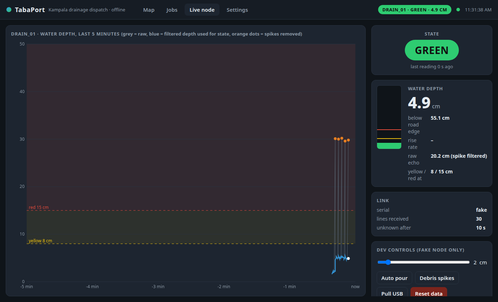

**Figure 12.** Live node. Grey is raw. Blue is filtered depth used for state. Orange dots are spikes removed (the Phase 2 plastic bottle filter, on screen). Yellow and red lines are Joel centimetres. Fake serial slider in this shot is for rehearsal. The IEEE tape uses the real USB node.

### 9.2 Map

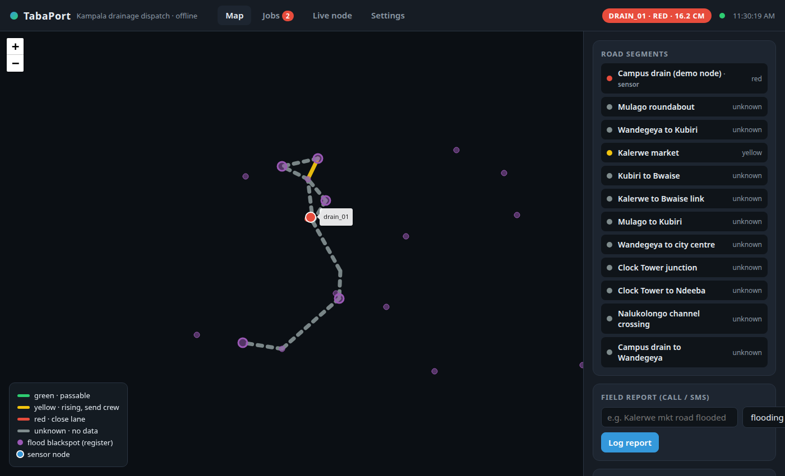

**Figure 13.** Map. Campus drain (drain_01) red. Purple dots are Trevor list (Clock Tower, Kalerwe, Bwaise, Mulago, Nalukolongo). Grey is unknown (no node). Field report box: a typed "Kalerwe mkt flooded" snaps through the gazetteer. Legend: green passable, yellow send crew, red close lane, grey no data.

### 9.3 Jobs

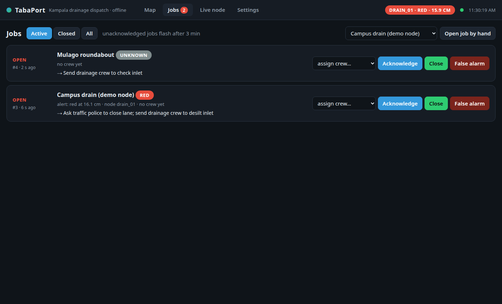

**Figure 14.** Jobs. Open job 3: campus drain **red** at 16.1 cm. *"Ask traffic police to close lane. Send drainage crew to clear inlet."* Open job 4: Mulago roundabout **unknown**. *"Send drainage crew to check inlet."* Unacked rows flash after 3 minutes. Buttons: assign, acknowledge, close, false alarm.

That is Joel language on Sharif table on Trevor place names, driven by Eric and Shakiran node.


## 10. Shakiran: firmware, join, IEEE, phone

After Phase 2 the lead job was not a new slogan. It was: keep the team on **one** first build slice, write firmware a real drain can drive, and put a person on the product.

**What we will not show in the IEEE video:** Wokwi, slides, a fake graph sold as a drain, cell broadcast, a city scale dashboard.

**Phone app (extra).** Flutter client, same REST API (prototype/mobile/). A physical phone starts at the public hub URL. The Linux desk stays on 127.0.0.1:5000. The Phase 3 tape is the **laptop**.

**Field node (sim only).** prototype/sysmatic/field_node. Heat sensor, battery, tilt, clock, LCD, microSD queue, MQTT stand in. Questions for a WSN teacher (power, LoRa versus GSM, box, lightning) are in docs/phase3/field-node-brief.md. **Not Phase 3 proof.**


## 11. The Phase 3 video

**Rule:** a real person, a working product, 2 to 5 minutes. No sim. No stock. No AI video.

| Role on the day | Person |
| --- | --- |
| Drain, probe, crew | Eric |
| Laptop, dispatcher | Shakiran |
| Camera 1 and site | Trevor |
| Water, timing, second camera | Joel |
| Hub standby | Sharif |

Shot list (aim about 3 min 30): wide drain, plank, box. Live node green, WiFi off. Pour to yellow, assign, ack. Pour to red, beep, map red. Crew clears inlet, sensor turns green, close. USB pull, grey unknown, plug back. Optional gazetteer and route that skips red. Team end card with the **five names**.


## 12. What we are not claiming

* That TabaPort stops flooding.
* That ultrasonic in a dirty **public** culvert is already good enough for live KCCA dispatch. That needs a 30 day trial beside patrol reports.
* Cell broadcast to every phone in 2 km.
* A public drain install. KCCA asset. Written permission first.
* That the Phase 2 US$55 solar radio node is what we filmed. We filmed a USB node.
* That we have already sat with a KCCA drainage engineer. We have not.
* That the 30 m score surface is a water model.


## 13. Next

1. Keep the first build as the SRS reference.
2. Ask Dr Mary Nsabagwa, Makerere CoCIS (embedded and WSN, WIMEA ICT weather stations) to mark the **field** node. Read [Nsabagwa et al. 2019](https://doi.org/10.1016/j.deveng.2018.100040) and [2018 condition watch](https://publications.eai.eu/index.php/IoT/article/view/661) first. Brief: docs/phase3/field-node-brief.md. Her four tests: reliability, accuracy, power, send. **Cost after those.**
3. Then a 20 minute KCCA Engineering **talk** (not a money ask): how reports reach crews today. Which 5 of 69 first. Whether a gentle demo on their land is ok.
4. One real flood spot, 30 days, side by side with patrols.


## 14. Files to send with the video

* This report as PDF
* SRS: docs/TabaPort_SRS.docx or print of docs/SRS.md
* Phase 2 PDF: docs/phase2/QM_Idea_5267_08_23_2026.pdf
* Research originals
  * docs/Research/Sharif_Research.docx
  * docs/Research/TabaPort_eric.docx
  * docs/Research/CalculationTabaPort.docx
  * docs/Research/TabaPort_GIS_Component_Report_to_MIIC_Mugisha_Trevour.pdf
  * docs/phase3/thresholds-and-words.md
* docs/phase3/wiring.md and docs/phase3/bom.md
* IEEE upload confirm screen shot
* Team photo or end card with the five names


## 15. Combined references

### Team files

1. TabaPort team (entrant: Shakiran Nannyombi). Phase 2 idea. Tabaport: On Site Edge Intelligence and Dispatch System for Urban Flash Floods. IEEE Response Quest 5267, 24 May 2026. docs/phase2/QM_Idea_5267_08_23_2026.pdf
2. Sharif. Software Requirements Specification, TabaPort first build. October 2026. docs/SRS.md
3. Sharif. TabaPort Research Document: Stack and Data. April 2026. docs/Research/Sharif_Research.docx
4. Eric. Drainage Sensor Placement for Urban Flood Monitoring. docs/Research/TabaPort_eric.docx
5. Eric. Time of flight, H_water, y_silt, blind zone and mount. docs/Research/CalculationTabaPort.docx
6. Mugisha Trevour Jeanclaude. TabaPort: GIS and Geomatics Component. Report to MIIC TES, 28 September 2026. docs/Research/TabaPort_GIS_Component_Report_to_MIIC_Mugisha_Trevour.pdf
7. Joel. Thresholds, job wording and the dispatcher lines. docs/phase3/thresholds-and-words.md
8. TabaPort team. MIIC TES concept note. docs/miic-tes-concept-note.md
9. TabaPort team. Research week brief. docs/phase3/team-research-week.md
10. TabaPort team. Wiring, BOM, shot list. docs/phase3/wiring.md, bom.md, rehearsal-and-shotlist.md

### News and agencies (posts we used)

11. KCCA. Drain and flood ready update (waste and silt). https://www.kcca.go.ug/news/1154/
12. UBC. KCCA steps up drainage works to tackle flooding in Kampala. 12 August 2026. https://ubc.go.ug/2026/08/12/kcca-steps-up-drainage-works-to-tackle-flooding-in-kampala/
13. Daily Monitor. Parliament gives KCCA 7 days to explain Kampala flooding. https://www.monitor.co.ug/uganda/news/national/parliament-gives-kcca-7-days-to-explain-kampala-flooding-5543126
14. NTV. KCCA urges land donation to solve Kampala flooding. https://ntv.co.ug/news/kcca-urges-land-donation-to-solve-kampala-flooding
15. OpenStreetMap Uganda. https://www.openstreetmap.org
16. Uganda National Meteorological Authority (climate context, Phase 2 form).
17. KCCA Strategic Plan 2025/26 to 2029/30. Drain and flood spot programmes (Eric).
18. Ministry of Works and Transport. Road Design Manual Volume II: Drainage Design Manual. 2010 (culvert minima cited by Eric. Confirm the current official PDF before you quote to KCCA).

### Technical papers

19. Nsabagwa, M., Byamukama, M., Kondela, E., and Otim, J. S. (2019). Towards a robust and affordable Automatic Weather Station. Development Engineering, 4, 100040. https://doi.org/10.1016/j.deveng.2018.100040
20. Nsabagwa, M., Sansa Otim, J., Nyongarwizi Akol, R., et al. (2018). Condition Monitoring for Wireless Sensor Network Based Automatic Weather Stations. EAI Endorsed Transactions on Internet of Things, 4(14), e4. https://publications.eai.eu/index.php/IoT/article/view/661
21. Toa, M., and Whitehead, A. (2021). Ultrasonic sensing basics (SLAA907D). Texas Instruments. (Eric)
22. Omega Engineering. LVCN210, LVCN318 and LVCN414 ultrasonic user guide, M4462. (Eric)
23. Hunan MAC Sensor. How to use, install and maintain ultrasonic level sensor. 2025. https://www.macsensor.com/info/how-to-use-install-and-maintain-ultrasonic-le-103166307.html
24. Icon Process Controls. Guide to radar liquid level sensors. 2025. https://iconprocon.com/blog_post/a-complete-guide-to-radar-liquid-level-sensors-precision-measurement-for-complex-applications/
25. JSN SR04T data sheet (blind zone, beam, cable. Use the sheet that came with the part).
26. Uganda Data Protection and Privacy Act. Phone numbers as personal data.
27. IEEE Response Quest Challenge rules. Real person, working product, 2 to 5 minutes.
28. Saaty AHP and Earth Engine inputs: MERIT Hydro, Copernicus DEM GLO 30, Dynamic World, CHIRPS (Trevor).


## Sign off

We confirm this report describes research and a prototype the team actually made after the Phase 2 idea. KCCA and UNDP numbers are labelled as theirs. Yellow and red centimetres are **our** rule from site shape, not a published national flood table.

| Name | Role | Date |
| --- | --- | --- |
| Shakiran Nannyombi | Lead and firmware | 7 October 2026 |
| Joel | Bands and dispatch words | 7 October 2026 |
| Eric | Drain and hardware | 7 October 2026 |
| Mugisha Trevour Jeanclaude | Maps | 7 October 2026 |
| Sharif | Software and SRS | 7 October 2026 |
